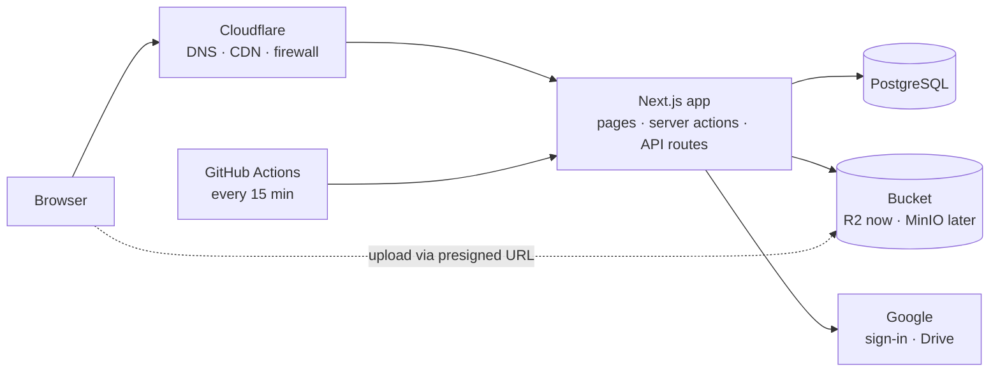

# Architecture

One Next.js app, one PostgreSQL database and one S3-compatible bucket. The app is stateless, so handling more traffic means running more copies of it. Every piece has an open-source equivalent, so the same Docker image runs on the cloud now and on college servers later.

| Piece | Build and pilot | College servers |
| --- | --- | --- |
| App | Vercel Hobby | `Dockerfile` image behind Nginx or Caddy |
| Database | Neon (free) | PostgreSQL 16 + PgBouncer |
| Bucket | Cloudflare R2 (free 10 GB) | MinIO |
| Edge | Cloudflare free plan | Cloudflare or Nginx caching |
| Retries | GitHub Actions cron calls `/api/jobs` | Same, or a host cron |

## Code map

| Path | Role |
| --- | --- |
| `src/lib/rules.ts` | Pure rules with unit checks: who may sign in, role ranks, upload limits, slugs, session signing |
| `src/lib/auth.ts` | Google OAuth, session cookie, `getUser()` / `requireRole()` |
| `src/lib/db.ts` | Prisma client |
| `src/lib/storage.ts` | Signed S3 requests (`aws4fetch`) |
| `src/lib/drive.ts` | Google Drive via a service account |
| `src/lib/media.ts` | Image processing (`sharp`) and the retry loop |
| `src/lib/form.ts` | Server-side form validation, the `act()` redirect-with-message helper, and `audit()` for the activity log |
| `src/lib/queries.ts` | Shared reads: current recruitment window, who can see an event, which events a user may upload to |
| `src/app/**/actions.ts` | Server actions: every write goes through one, and each starts with a role check |
| `src/app/media/[id]/[size]` | Permission-checked file delivery |
| `src/app/api/jobs` | Retries stuck processing (cron, needs `CRON_SECRET`) |
| `src/app/api/health` | Health check for uptime monitors |

## Sign-in

1. `/auth/google` sets a random `state` cookie and redirects to Google with `hd=ltsu.ac.in`.
2. Google redirects to `/auth/callback`. The app checks `state`, exchanges the code for an ID token over HTTPS with the client secret, and requires `email_verified` and an `@ltsu.ac.in` address. The `hd` hint alone is never trusted.
3. The user row is created or updated. Emails listed in `OWNER_EMAILS` become owners on first sign-in, which bootstraps the first two owners.
4. The session cookie (`vs`) holds the user id and an expiry, signed with HMAC-SHA256 (`SESSION_SECRET`). It is `HttpOnly`, `Secure`, `SameSite=Lax` and lasts 30 days.
5. Every request reads the role from the database, so a demoted admin loses access on their next click.

Roles: `student < member < admin < owner`. A Contributor isn't a role: it's an `UploadInvite` row for one event, which expires 14 days after the event.

## Upload pipeline

1. The phone asks the `requestUploads` action for upload URLs. It checks the role or invite, file type and size, then creates `Media` rows (`uploading`) and returns presigned PUT URLs that expire in 15 minutes.
2. The phone PUTs each file straight to the bucket, with per-file progress.
3. The phone calls `confirmUpload`. The app checks the stored size, marks the row `processing` and processes it right away.
4. Processing (`src/lib/media.ts`): auto-rotate, strip all metadata including GPS, write a 1600 px display copy and a 480 px thumbnail as WebP, move the original to the club Drive folder (or keep it in the bucket if Drive isn't configured), then mark the row `pending`.
5. If processing fails, the row stays `processing` with `attempts + 1`. The cron route retries it up to 3 times, then marks it `failed`.
6. An admin approves or rejects it. Only `approved` items appear in albums and search.

A Drive import does the same from step 3, except the original is downloaded from Drive and stays there.

## Media delivery

`/media/[id]/thumb|display|original` loads the row and decides who may see it:

- Approved media in a public, unarchived event: anyone. Sent with `Cache-Control: public, max-age=3600, s-maxage=86400`, so Cloudflare serves repeats for a day and browsers for an hour.
- Approved media in a members-only event: members and above.
- Anything else: only the uploader and admins (`private, no-store`).

Removed media therefore stops being served by the app at once. It drops out of browsers within an hour and out of the CDN within a day; for an urgent takedown, purge the URL in the Cloudflare dashboard.

## Security checklist

- Every server action and admin route starts with `requireRole()` or an ownership check. Hiding a button is never the protection.
- Form input is validated on the server (`src/lib/form.ts`) before it reaches the database.
- The bucket is private; files are only reachable through the permission check above.
- Uploads are checked by type and by the stored size after upload. `sharp` re-encodes every image, which also defeats files disguised as images.
- The activity log is append-only. In production, grant the app's database user no `UPDATE` or `DELETE` on `ActivityLog` (SQL in the [runbook](RUNBOOK.md)).
- Secrets live only in environment variables; `.env` is git-ignored.
- Rate limits and bot protection are Cloudflare rules, so changing them needs no deploy.

## Scaling ceilings

| Part | Holds until | Then |
| --- | --- | --- |
| App copies | The database connection limit | Use the pooled connection string; add copies |
| Database | About 70% CPU sustained | Add a read replica |
| Search (`contains`) | Roughly 100k media items | Add `pg_trgm` indexes, then Meilisearch |
| Inline processing | Big fest uploads (5,000 files in an hour) | A dedicated worker container that runs `processPending()` in a loop |
| Media through the app | High bandwidth bills | Public bucket or CDN domain for public files |
